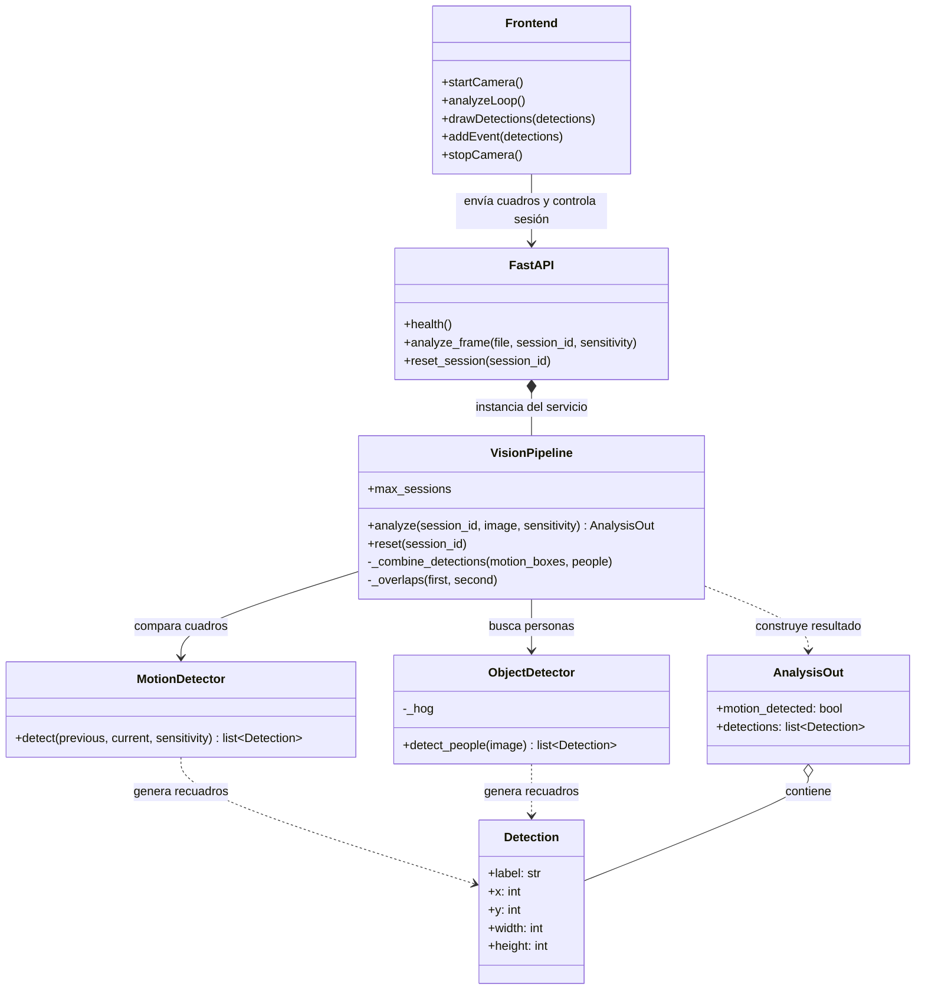

# Materia
Técnicas de Procesamiento Digital de Imágenes

# Año y cuatrimestre de cursada
2 do año - segundo cuatrimestre

# Nombre y apellido
Abel Pablo Vincenti

# Docente
Juan Ignacio Bonini

# Que los motivo a crear lo que crearon
Inicialmente iba a hacer un motion detector con imagenes crudas y en distintos colores, y despues de una charla en una clase presencial y con la guía del profesor, decídi hacer un full motion detector que a futuro, cuando me compre un par de camaras,  lo instalaré en un servidor propio para usarlo en la oficina laboral y en mi casa

# Que problemáticas encontraron y como las resolvieron
Al principio algunas cosas parecían errores de la cámara, pero al revisar el recorrido completo vimos que también podían fallar el navegador, el frontend o el backend. Estas fueron las principales dificultades y cómo las fui resolviendo:

### 1. El backend no respondía

**Qué pasaba:** la página podía abrirse, pero al analizar una imagen aparecía un error de conexión. El navegador enviaba los cuadros a la API local, que no estaba iniciada o no estaba disponible.

**Cómo lo resolví:** comprobé que se estaba ejecutando en el puerto correcto y agregué una ruta sencilla, `/api/health`, para verificar si respondía. Cuando algo así pasa, conviene revisar primero la terminal del backend y probar `http://127.0.0.1:8000/api/health`; si no responde, el problema está antes de la detección de movimiento.

### 2. Se estaba usando el Python equivocado

**Qué pasaba:** Uvicorn podía arrancar con una instalación global de Python, distinta del entorno virtual del proyecto. En ese caso OpenCV no tenía disponible `HOGDescriptor`, necesario para detectar personas.

**Cómo lo resolví:** activé el entorno virtual de `backend` e inicie Uvicorn desde ahí con `python -m uvicorn`. Para evitar confusiones, antes de investigar el algoritmo revisaría qué Python ejecuta el servidor y si desde ese mismo entorno se pueden importar las dependencias.

### 3. Un error de análisis apagaba la cámara

**Qué pasaba:** si fallaba una solicitud al backend, el frontend detenía la cámara aunque el problema fuera solamente la conexión o el análisis.

**Cómo lo resolví:** separé el error de análisis de la acción de apagar la cámara. Ahora se informa el error y se vuelve a intentar con los cuadros siguientes; la cámara se detiene cuando se usa el botón **Detener**. Al depurar algo parecido, revisaría qué función se llama al producirse el error y evitaría que un fallo recuperable cierre recursos que todavía funcionan.

### 4. La dirección del backend mostraba «Not Found» o no conectaba

**Qué pasaba:** la raíz `http://127.0.0.1:8000/` no es una página web, y además el servidor puede estar apagado. Son situaciones distintas: una ruta que no existe puede dar 404; un servidor apagado suele dar un error de conexión.

**Cómo lo resolví:** puse qué dirección corresponde a cada cosa: el frontend se abre en el puerto 5500, la API se comprueba en `/api/health` y su documentación está en `/docs`. Cuando aparece un error, primero miraría la URL completa y el estado del servidor antes de cambiar código.

### 5. El primer cuadro no detecta movimiento

**Qué pasaba:** para saber qué cambió, el detector necesita comparar dos cuadros. El primero no tiene con qué compararse.

**Cómo lo resolví:** usé el primer cuadro de cada sesión como referencia y empezé a buscar movimiento a partir del siguiente. Si al activar la cámara no aparece una detección de inmediato, eso es esperado; probaría moviendo algo frente a la cámara y revisaría la sensibilidad.


# link a github
https://github.com/Beaor/tp-final-vincenti-tec-proc-img

# link a vercel
https://tp-final-vincenti-tec-proc-img-back.vercel.app/

# Vigía — detector de movimiento con cámara

Aplicación local de visión por computadora para mostrar una cámara en vivo, detectar cambios entre cuadros y marcar personas cuando coinciden con una zona en movimiento. Está separada en un frontend web y un backend Python con FastAPI y OpenCV.

## Qué hace

- Pide permiso para acceder a la cámara y muestra una vista previa en el navegador.
- Captura y envía un cuadro JPEG al backend aproximadamente cada medio segundo mientras la cámara está activa.
- Detecta movimiento comparando el cuadro actual con el anterior de la misma sesión.
- Busca personas con el detector HOG incluido en OpenCV, sin descargar modelos adicionales.
- Dibuja las detecciones sobre la vista previa y agrega eventos recientes con miniaturas.
- Permite ajustar la sensibilidad y limpiar la lista de eventos.
- Procesa las imágenes en la computadora local; el frontend se comunica únicamente con la API local configurada en `http://127.0.0.1:8000`.

La detección de persona se presenta únicamente cuando su recuadro coincide con una zona de movimiento. Si se detecta movimiento que no coincide con una persona, se muestra como «Movimiento».

## Cómo funciona

1. Al pulsar **Activar cámara**, el navegador solicita permiso mediante `getUserMedia`. El video se muestra localmente.
2. El frontend captura cuadros, los codifica como JPEG y envía cada uno a `POST /api/analyze` junto con un identificador de sesión y la sensibilidad seleccionada.
3. FastAPI valida la solicitud, decodifica la imagen con OpenCV y reduce su tamaño si alguna dimensión supera 800 píxeles.
4. `VisionPipeline` convierte el cuadro a escala de grises y conserva el cuadro anterior por sesión. El primer cuadro solo establece la referencia; por eso no genera detecciones.
5. `MotionDetector` calcula la diferencia absoluta entre cuadros, aplica un umbral y operaciones morfológicas para quitar ruido y agrupar regiones. Descarta regiones menores que el área mínima configurada.
6. Si hay movimiento, `ObjectDetector` ejecuta HOG sobre la imagen a color. El pipeline conserva las detecciones de personas que se superponen con las zonas de movimiento y combina los recuadros para la respuesta.
7. El frontend dibuja los recuadros recibidos y agrega un evento como máximo cada cuatro segundos. Conserva hasta ocho eventos en la lista.
8. Al pulsar **Detener**, se paran las pistas de cámara, se limpia la vista y se solicita borrar el estado de esa sesión mediante `DELETE /api/sessions/{session_id}`.

### Sensibilidad

El control acepta valores entre 0 y 100. El detector calcula el umbral de diferencia como `max(12, 55 - round(sensibilidad * 0.43))`: a mayor sensibilidad, menor umbral y más cambios pueden considerarse movimiento. La limpieza morfológica y el área mínima también ayudan a reducir falsos positivos pequeños.

### Qué pasa si falla el análisis

Si una solicitud al backend falla, el frontend muestra el error en el estado de la cámara y vuelve a intentar con los cuadros siguientes. Ese error ya no detiene las pistas de la cámara: para apagarla se usa el botón **Detener**. Si un cuadro se analiza correctamente después del error, el estado vuelve a indicar «Cámara activa».

## Arquitectura y diagrama de clases

El navegador gestiona la cámara y la interfaz. La API valida y decodifica cuadros, y delega el análisis al pipeline. Las flechas del diagrama muestran las dependencias principales y las líneas discontinuas indican los modelos que se devuelven o validan.



### Componentes

| Componente | Responsabilidad |
| --- | --- |
| `frontend/index.html` | Estructura de la página: video, canvas superpuesto, controles, ajustes y actividad reciente. |
| `frontend/styles.css` | Presentación adaptable de la interfaz. |
| `frontend/app.js` | Acceso a cámara, captura periódica, llamadas a la API, dibujo de recuadros, errores y lista de eventos. |
| `app/main.py` | Crea la API FastAPI, configura CORS, define los endpoints, valida y decodifica imágenes, aplica límites y llama al pipeline. |
| `app/vision/pipeline.py` | Coordina los detectores, conserva cuadros anteriores por sesión, combina resultados y elimina el estado de una sesión. |
| `app/vision/motion_detector.py` | Detecta regiones con cambios entre cuadros usando operaciones de OpenCV. |
| `app/vision/object_detector.py` | Ejecuta el detector de personas HOG de OpenCV. |
| `app/schemas.py` | Define los modelos de respuesta `AnalysisOut` y `Detection` con Pydantic. |

El pipeline protege el estado compartido con un lock y conserva como máximo 32 sesiones; cuando se supera el límite, elimina la sesión menos recientemente usada. El estado de referencia se mantiene en memoria del backend.

## API local

| Método | Ruta | Uso |
| --- | --- | --- |
| `GET` | `/api/health` | Comprueba que la API responde; devuelve `{"status":"ok"}`. |
| `POST` | `/api/analyze` | Recibe un cuadro JPEG, `session_id` y `sensitivity` como multipart/form-data. Devuelve `motion_detected` y una lista de detecciones. |
| `DELETE` | `/api/sessions/{session_id}` | Elimina el cuadro de referencia de esa sesión. |

La solicitud de análisis admite imágenes de hasta 2 MB, un `session_id` de 1 a 100 caracteres y sensibilidad de 0 a 100. Las imágenes inválidas se rechazan. Las dimensiones mayores a 800 píxeles se reducen antes del análisis.

La raíz del backend (`http://127.0.0.1:8000/`) no es la página de la aplicación y puede responder **404 Not Found**. La documentación interactiva de FastAPI está en `http://127.0.0.1:8000/docs`; la aplicación se abre desde el servidor del frontend.

## Requisitos

- Windows.
- Python 3.10 o superior.
- Navegador moderno con soporte de cámara.
- Permiso del navegador para utilizar la cámara. `localhost` y `127.0.0.1` se consideran contextos seguros.

## Instalación y ejecución en Windows

Abrí dos terminales en la carpeta del proyecto: `detector-camara`.

### 1. Preparar e iniciar el backend

```powershell
cd backend
py -m venv .venv
.\.venv\Scripts\Activate.ps1
python -m pip install -r requirements.txt
python -m uvicorn app.main:app --reload --host 127.0.0.1 --port 8000
```

Usá el Python del entorno virtual para iniciar Uvicorn. Esto garantiza que el servidor utilice las dependencias instaladas para el proyecto, incluido OpenCV con soporte HOG. No cierres esta terminal mientras uses la aplicación.

- API: `http://127.0.0.1:8000`
- Comprobación: `http://127.0.0.1:8000/api/health`
- Documentación de API: `http://127.0.0.1:8000/docs`

### 2. Iniciar el frontend

En una segunda terminal, desde la raíz del proyecto:

```powershell
cd frontend
python -m http.server 5500
```

Abrí `http://127.0.0.1:5500/`. No abras el archivo HTML directamente ni uses la raíz del backend para entrar a la interfaz.

## Pruebas

Con el entorno virtual del backend activado:

```powershell
cd backend
python -m pytest -q tests
```

Las pruebas cubren el primer cuadro como referencia inicial, la detección de un cambio entre cuadros, el reinicio de sesión, el filtrado de personas que no coinciden con movimiento y el endpoint de análisis.

## Estructura del proyecto

```text
detector-camara/
├── README.md
├── backend/
│   ├── requirements.txt
│   ├── app/
│   │   ├── __init__.py
│   │   ├── main.py
│   │   ├── schemas.py
│   │   └── vision/
│   │       ├── __init__.py
│   │       ├── motion_detector.py
│   │       ├── object_detector.py
│   │       └── pipeline.py
│   └── tests/
│       ├── test_api.py
│       └── test_pipeline.py
└── frontend/
    ├── app.js
    ├── index.html
    └── styles.css

```
