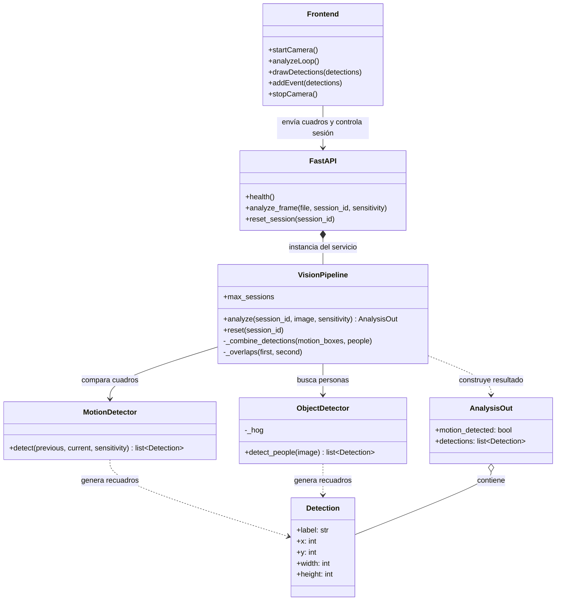

## Arquitectura y diagrama de clases

El navegador gestiona la cámara y la interfaz. La API valida y decodifica cuadros, y delega el análisis al pipeline. Las flechas del diagrama muestran las dependencias principales y las líneas discontinuas indican los modelos que se devuelven o validan.
